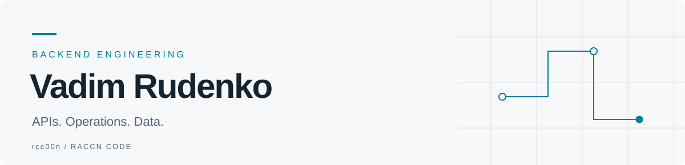

<picture>
  <source media="(prefers-color-scheme: dark)" srcset="assets/profile-dark.svg">
  <source media="(prefers-color-scheme: light)" srcset="assets/profile-light.svg">
  
</picture>

I build backend systems and the interfaces around them: business operations,
booking and commerce, and data-intensive research tools.

Based in **Edmonton** · **Raccoon Software**  
[Portfolio](https://raccncode.com/) · [Email](mailto:vadrud2016@gmail.com) · [Telegram](https://t.me/Rac_c00n)

## Selected work

| Project | What it explores | Core stack |
| --- | --- | --- |
| **[QUANTIX](https://github.com/rcc00n/QUANTIX)** | Public market intelligence, depth-aware research and auditable **paper-only** execution. | FastAPI · PostgreSQL · Next.js |
| **[BGM CRM](https://github.com/rcc00n/bgm_crm)** | Automotive-service CRM, bookings, storefront and dealer operations. | Django · PostgreSQL |
| **[Booking](https://github.com/rcc00n/booking)** | Salon/spa scheduling, client intake, staff workflows and Stripe payments. | Django · Stripe · Telegram |
| **[GreenContract](https://github.com/rcc00n/GreenContract)** | Fleet and rental records, seasonal pricing and DOCX/PDF documents. | Django · DOCX/PDF |
| **[Vancouver Milk Co](https://github.com/rcc00n/MilkVancouver)** | A dairy-commerce monorepo with a React storefront and Django API. | React · TypeScript · Django |
| **[Portfolio](https://github.com/rcc00n/portf)** | Project presentation, pricing and contact flows with a Django-backed website. | React · Vite · Django |

QUANTIX submits no real exchange orders. Observed spreads and simulated outcomes
are research results, not evidence of real-world profitability.

## Inside the engineering

Three short cases connect the source, design decisions and known limits:

- **[QUANTIX](https://github.com/rcc00n/QUANTIX/blob/main/docs/ENGINEERING_CASE_STUDY.md):** exact accounting, independent execution legs and causal market evidence. [Synthetic workspace demo](https://github.com/rcc00n/QUANTIX/blob/main/docs/DEMO.md).
- **[BGM CRM](https://github.com/rcc00n/bgm_crm/blob/master/docs/ENGINEERING_CASE_STUDY.md):** scheduling validation and catalogue workflows on PostgreSQL. [Synthetic staff demo](https://github.com/rcc00n/bgm_crm/blob/master/docs/DEMO.md).
- **[GreenContract](https://github.com/rcc00n/GreenContract/blob/main/docs/ENGINEERING_CASE_STUDY.md):** rental pricing and consistent document generation. [Synthetic rental demo](https://github.com/rcc00n/GreenContract/blob/main/docs/DEMO.md).

[Download the one-page engineering portfolio (PDF)](assets/engineering-portfolio.pdf).
All demonstrations use labelled synthetic records; verification scope and limitations are documented in each project.

## Engineering focus

- **Domain logic:** explicit contracts, permissions and state transitions.
- **APIs and data:** Python, Django, FastAPI, PostgreSQL and exact financial arithmetic.
- **Product interfaces:** React, TypeScript and server-rendered applications.
- **Operations:** Docker, Linux, NGINX and documented deployment/recovery workflows.

I am interested in backend work where the data model and operational details matter.
[Get in touch](mailto:vadrud2016@gmail.com).
